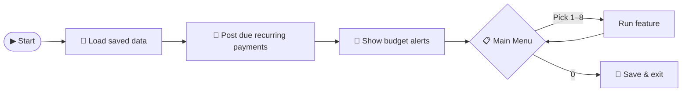
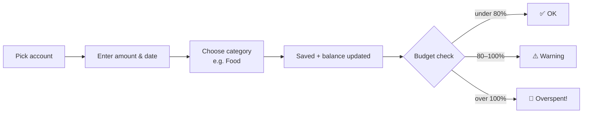

<div align="center">

# 💰 Personal Finance & Budget Manager

**Know where every rupee goes.**
A menu-driven C console app that tracks your money across accounts, catches overspending before it happens, and turns each month into a clear report.


*Programming Fundamentals semester project · BCS-1C · FAST-NUCES Karachi*

**🌐 [Try the web demo](https://personal-finance-budget-manager-web.vercel.app/)** (a JavaScript copy of the app; the graded project is the C program in `src/`)

</div>

---

## 🧐 The Problem

Most people track money with spreadsheets, banking apps, or a notebook, and all three fall short:

- 📊 **Spreadsheets** need you to build every formula yourself and never warn you when you go over a budget.
- 🏦 **Banking apps** show one account at a time, with fixed categories and no savings goals.
- 📓 **Notebooks** can't search, add up totals, or compare one month with another.

So overspending is usually found out **after** the money is gone. Rent and subscriptions get typed in again every month, and nobody knows how close their savings goal really is.

## 💡 Our Solution

One program that manages **all your accounts in one place** and **analyses** your spending, not just records it:

> Log an expense → it's sorted into a category → the budget is checked right away → you get a warning **before** you overspend.

---

## ✨ Features

| | Feature | What it does |
|:-:|---|---|
| 🏦 | **Multiple accounts** | Cash, bank and savings, each with a running balance and a total net worth |
| 🧾 | **Smart transaction log** | Income and expenses with a note, in a list that grows as needed (no fixed limit) |
| 🔀 | **Transfers** | Move money between your own accounts |
| 🏷️ | **Categories** | Food, Transport, Rent, Utilities and Other |
| 🎯 | **Monthly budgets** | Set a limit per category and see how much of it is used |
| 🚨 | **Overspend alerts** | ⚠️ Warning at 80% used · 🔴 Alert once the limit is crossed |
| 📅 | **Spending grid** | Month × category table showing where your money went all year |
| 🔁 | **Recurring payments** | Rent and subscriptions added automatically each month (day 1–28) |
| 🐷 | **Savings goals** | Named goals with progress toward a target, e.g. *"Laptop – 150,000"* |
| 🔍 | **Search & filter** | Find transactions by note keyword, category, amount range or month |
| 📄 | **Reports** | Monthly report and a year summary |
| 💾 | **Saved automatically** | Accounts, budgets, goals and recurring payments are saved to text files, so your data is still there next time |

---

## 🔄 How It Works



**Adding an expense, step by step:**



---

## 🖥️ Sneak Peek

```
=========== PERSONAL FINANCE MANAGER ===========
 [Auto-posted] Rent  -25,000  (01/10/2026)
 [!] Food: 112% of budget used this month
------------------------------------------------
 1. Accounts        5. Savings Goals
 2. Transactions    6. Search & Filter
 3. Categories      7. Recurring
 4. Budgets         8. Reports
 0. Save & Exit
Enter choice: _
```

```
BUDGET STATUS - October 2026
Category      Spent    Limit    Used
Food          8,500   10,000   [########--]  85%  WARNING
Rent         27,500   25,000   [##########] 110%  OVERSPENT
Transport     2,100    4,000   [#####-----]  52%
```

```
SAVINGS GOALS
Laptop     [#########-----------]  45%   67,500 / 150,000
Emergency  [##############------]  70%   35,000 /  50,000
```

*(Sample screens, with example numbers.)*

---

## 🧠 C Concepts Used

| Week | Concept | Where it's used |
|:-:|---|---|
| 3–5 | 🔀 **Variables, if/else, switch** | Menu-driven interface with nested sub-menus |
| 7 | 🔁 **Loops & intro pointers** | Menu loop, progress bars, balance updated through a pointer |
| 8 | 📦 **1D arrays** | Accounts, category names, budget limits |
| 9 | 🧮 **Nested loops & 2D arrays** | Month × category spending table |
| 10 | 🧩 **Functions & pointers** | Modular code, balances updated by reference |
| 11 | 🔤 **Strings, `const`, `time.h`** | Keyword search (`strstr`, `strcmp`, `tolower`), recurring payments use today's date |
| 13 | 🏗️ **Structures** | Accounts, transactions, dates, goals, recurring payments |
| 14 | 🧠 **Dynamic memory** | Growing transaction, goal and recurring lists (`malloc`, `realloc`, `free`) |
| 15 | 💾 **File handling** | Saving and loading accounts, budgets, goals and recurring payments |

*Only syntax from the course slides is used, in the order the course teaches it. Progress: **Week 15, all topics covered**.*

---

## 🚀 Getting Started

**You need:** a C compiler (GCC / MinGW) and a terminal.

```bash
# clone the repo
git clone https://github.com/syedmoaz14/Personal-Finance-Budget-Manager.git
cd Personal-Finance-Budget-Manager

# build
gcc -Wall -Wextra src/*.c -o finance

# run
./finance        # Linux
finance.exe      # Windows
```

Your data is saved as `accounts.txt`, `budgets.txt`, `goals.txt` and `recurring.txt` in the folder you run it from.

---

## 👥 Team

| Member | Roll No. | Responsibilities |
|---|---|---|
| **Syed Moaz Ali** | 26K-0630 | ⚙️ Core engine: main program, accounts & transactions, categories, spending grid, saving to files, search, recurring payments, integration |
| **Syeda Maryam Fatima** | 26K-0618 | 🎨 Interface & budgets: menus, input validation, budgets & alerts |
| **Varaa** | 26K-0633 | 🧩 Extras: savings goals and reports |

---

## 📚 Documentation

- 📘 [Project overview & flowcharts](docs/OVERVIEW.md)
- 🗺️ [Design & work plan](docs/PLAN.md)

<div align="center">

Made with ☕ and `printf` by Moaz, Maryam & Varaa

</div>
